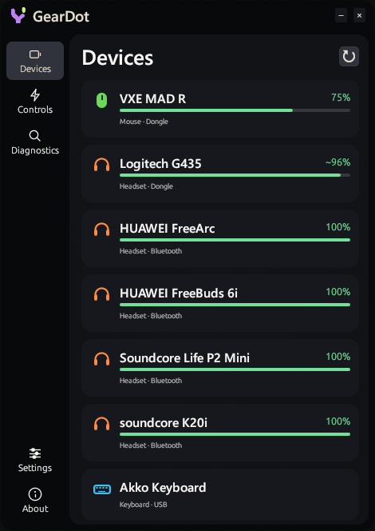

# 🔋 GearDot – Windows Battery Monitor

  

  Battery readings for connected mice, keyboards, headsets, earbuds, and controllers on Windows.

  
  
  
  

---

## 📌 About the Project

**GearDot** is a Windows desktop utility that keeps battery information for compatible peripherals in one place. Open the device list from the notification area, show battery percentages next to the taskbar, or check them in the screen-edge slider. GearDot reads device information locally through Windows APIs and bundled device readers.

---

## ✨ Key Features

- 🔌 **Connected devices** — See which devices GearDot has detected and how they are connected. The list updates as devices connect and disconnect.
- 🔋 **Battery information** — View a reported percentage, an estimate, or a coarse level depending on the device. GearDot shows charging and full-charge states when it can determine them.
- 📍 **Taskbar and edge slider** — Choose where each device appears. Hover over the slider to see the device name and battery details.
- 🔔 **Battery alerts** — Configure low-battery and full-charge notifications, or mute alerts temporarily from **Controls**.
- ⚙️ **Device profiles** — Rename a device in GearDot, pin it to the top, and control where it appears.
- 🧾 **Diagnostics** — Refresh the device list and copy a report when a device is missing or a reading looks wrong.

---

## 🖼️ See GearDot in Action

  

**One view for your setup.** See your mouse, headset, earbuds, and keyboard together. Each device shows its connection type next to the available battery reading.

  

**Battery levels at a glance.** Keep the percentages beside the Windows notification area while you work or play. Use **Controls** to enable the screen-edge slider if you prefer the battery rings there.

GearDot development captures. Available readings depend on the connected devices.

---

## 🎮 Device Support

Match the **model and connection mode** below. Firmware and USB receiver IDs can affect the available reading. GearDot can also show wired or Bluetooth devices whose battery level it cannot retrieve.

**Validation** identifies readings observed during GearDot testing or models covered by an included reader. A driver in the source does not confirm a hardware test in GearDot.

| Category | Model or family | Connection | Reader and validation |
|---|---|---|---|
| Mouse | **VXE MAD R** | 2.4 GHz receiver `373B:1040` or USB `373B:103F` | GearDot reader. Receiver percentage observed in GearDot |
| Mouse | Logitech MX Master series and compatible G mice | Unifying, Bolt, or LIGHTSPEED receiver, USB or Bluetooth on supported models | BatteryHub / W.D.B.M HID++ |
| Mouse | SteelSeries Aerox 3/5/9 Wireless, Prime Wireless, Rival 650 | Supported receiver or USB cable | W.D.B.M |
| Mouse | HyperX Pulsefire Haste 2 Wireless / Mini / Core Wireless | Supported 2.4 GHz receiver | W.D.B.M |
| Mouse | WLMouse Beast X 8K, Beast X Mini, Beast MAX | Supported 2.4 GHz receiver or USB cable | W.D.B.M |
| Mouse | Ninjutso Sora V2 and Ten Air | Supported 2.4 GHz receiver or USB cable | W.D.B.M |
| Mouse | Rapoo VT3 Max Gen 2 and VT9 Gen 2 | Supported 2.4 GHz receiver or USB cable | W.D.B.M. Check the exact receiver ID |
| Mouse | Dareu EM901X and A980 Pro | Supported 2.4 GHz receiver or USB cable | W.D.B.M |
| Keyboard | AULA F75, F87 Pro, F99 | Supported 2.4 GHz receiver | W.D.B.M |
| Keyboard | CHERRY MX 3.0S Wireless | Receiver `046A:00EA` or USB `046A:00E3` | W.D.B.M. Bluetooth uses the Windows reading when available |
| Keyboard | AJAZZ AK820 MAX and EPOMAKER EA75 | Compatible SONiX 2.4 GHz receiver | W.D.B.M. Match the receiver and interface |
| Keyboard | MCHOSE G75 V2 | 2.4 GHz receiver `3837:3033` | W.D.B.M |
| Keyboard | Keychron K5 Max | Supported USB cable or Keychron Link receiver with patched firmware | W.D.B.M. Stock firmware battery reporting uses Bluetooth |
| Headset | **Logitech G435** | LIGHTSPEED receiver `046D:0ADF` | GearDot and upstream fallbacks. Estimated percentage observed in GearDot |
| Headset | Logitech G533, G735, G PRO X 2 LIGHTSPEED | Supported 2.4 GHz receiver | BatteryHub / W.D.B.M |
| Headset | ASTRO A50 Gen 4 or Gen 5 | Supported USB base station in PC mode | BatteryHub / W.D.B.M |
| Headset | SteelSeries Arctis 7/7+/9 and Arctis Nova Pro Wireless | Supported wireless transmitter or base station | W.D.B.M |
| Headset | Corsair Void Elite Wireless, HS70 Wireless, HS80 Wireless | Supported USB receiver | BatteryHub / W.D.B.M |
| Headset | HyperX Cloud II Wireless, Cloud III Wireless and Cloud Alpha Wireless | Supported 2.4 GHz receiver | BatteryHub / W.D.B.M |
| Headset | Audeze Maxwell, Sony INZONE H5/H9 II, JBL Quantum 350 | Supported USB receiver | BatteryHub and/or W.D.B.M depending on model |
| Earbuds | HUAWEI FreeArc, FreeBuds 6i, Soundcore Life P2 Mini and K20i | Bluetooth | Battery values observed in GearDot via Bluetooth monitoring |
| Earbuds | Samsung Galaxy Buds2 Pro and Buds FE | Bluetooth | W.D.B.M. Close the Galaxy Buds app if it holds the connection |
| Earbuds | Nothing Ear (a), Ear (2), CMF Buds | Bluetooth | W.D.B.M |
| Earbuds / headset | Apple AirPods and compatible Beats | Bluetooth | BatteryHub / W.D.B.M. Windows must report the device connected |
| Controller | DualSense and DualSense Edge | USB, plus compatible Bluetooth reports | GearDot USB reader / bundled Sony readers |
| Controller | Xbox controllers with battery reporting | Bluetooth or wireless adapter, depending on model | Windows battery APIs / XInput. Some models report a level only |
| Controller | 8BitDo Ultimate 2 Wireless and Ultimate 2C Wireless | Supported connection and input mode | W.D.B.M. Check firmware and mode in the upstream table |
| Controller | GameSir G7 Pro 8K PC and Nova 2 Lite | Supported 2.4 GHz receiver or USB | BatteryHub / W.D.B.M |
| Controller | GameSir Cyclone 2 and BEITONG KP20 | Supported receiver in XInput mode; Cyclone 2 also supports USB | W.D.B.M |

Many additional models are listed by the included projects. Use these tables to check receiver IDs, firmware, and upstream hardware test notes. [BatteryHub devices](vendor/batteryhub-rust/README.md#supported-devices) · [W.D.B.M devices](vendor/wdbm-cpp/README.md#supported-devices) · [HeadsetControl headset list](https://github.com/Sapd/HeadsetControl#supported-headsets)

| Display | Meaning |
|---|---|
| **Percentage** | The device, Windows, or a bundled reader supplied a percentage |
| **Estimated percentage** | A voltage reading or a device battery level was converted to a percentage, as with the supported G435 receiver |
| **Level only** | The device supplied a coarse value such as Low, Medium, or Full |
| **Battery unavailable** | GearDot detected the device and could not obtain a supported battery reading |

The complete driver source trees are included under [`vendor/`](vendor/README.md). The upstream projects document model support and prerequisites. [BatteryHub](https://github.com/ferloom/Wireless-Device-Battery-Monitor) · [W.D.B.M](https://github.com/SymbianDevAhmed/W.D.B.M) · [HeadsetControl](https://github.com/Sapd/HeadsetControl#supported-headsets)

---

## 📥 Download and Run

Download a Windows x64 package from [GitHub Releases](https://github.com/SymbianDevAhmed/GearDot/releases/latest).

| Package | How to use it |
|---|---|
| **EXE installer** | Run `GearDot-Setup-x64.exe` and open **GearDot** from the Start menu |
| **MSI installer** | Run `GearDot-Setup-x64.msi` if you prefer Windows Installer |
| **Portable ZIP** | Extract the full ZIP to a writable folder and run `GearDot.exe` |

Choose one installer. For Portable, keep `portable.flag`, `GearDot-DeviceProbe.exe`, and `HeadsetControl.exe` alongside `GearDot.exe`. If an earlier test build is running, exit it from the notification area first. Windows Installer may require uninstalling a higher-numbered test MSI before installing the first stable release.

---

## ▶️ Using GearDot

1. Connect your device over USB, its wireless receiver, or Bluetooth.
2. Click the **GearDot** icon in the notification area to open **Devices**. Use the refresh control to scan again.
3. Open **Controls** for taskbar, edge slider, and alert options. Open **Settings → Device profiles** to choose where each device appears.
4. For a missing device or incorrect reading, open **Diagnostics → Copy diagnostic report**. Include the model, connection type, and expected battery reading when [opening an issue](https://github.com/SymbianDevAhmed/GearDot/issues).

---

## 📊 Resource Usage

| Release package | Download size |
|---|---:|
| Portable ZIP | 4.05 MiB |
| EXE installer | 4.39 MiB |
| MSI installer | 4.28 MiB |

GearDot runs in the notification area and launches the bundled readers when it scans devices. Memory and CPU use depend on the number of connected devices, refresh settings, and whether the device window is open.

The [Windows measurement workflow](.github/workflows/benchmark.yml) samples the released Portable build with the device window closed. It reports the GearDot process working set and CPU average separately from package size.

---

## 🛠️ Technologies & Tools

  
  
  
  

| Path | Contents |
|---|---|
| [`src/`](src/) | Windows app, device detection, reader integration, and diagnostics |
| [`vendor/`](vendor/) | BatteryHub and W.D.B.M sources and integration notes |
| [`installer/`](installer/) | EXE, MSI, and Portable packaging files |
| [`tests/`](tests/) | Protocol fixtures and automated checks |

To build from source on Windows, install Rust 1.99 or newer, Visual Studio Build Tools with the C++ workload, and MinGW-w64 on your PATH. Run `BUILD.cmd` from the repository root. See [contributing notes](CONTRIBUTING.md), [packaging instructions](installer/README.md), and the [changelog](CHANGELOG.md).

---

## 📄 Licence and Credits

GearDot is released under the [GNU General Public License v3 or later](LICENSE). See the [third-party notices](THIRD-PARTY-NOTICES.txt) and [vendored source revisions](vendor/README.md) for BatteryHub, W.D.B.M, and HeadsetControl.

> [!NOTE]
> Unofficial project. GearDot is not affiliated with Logitech, VXE, or ATK.

---

## 👨‍💻 Author

**Ahmed Gaber**
